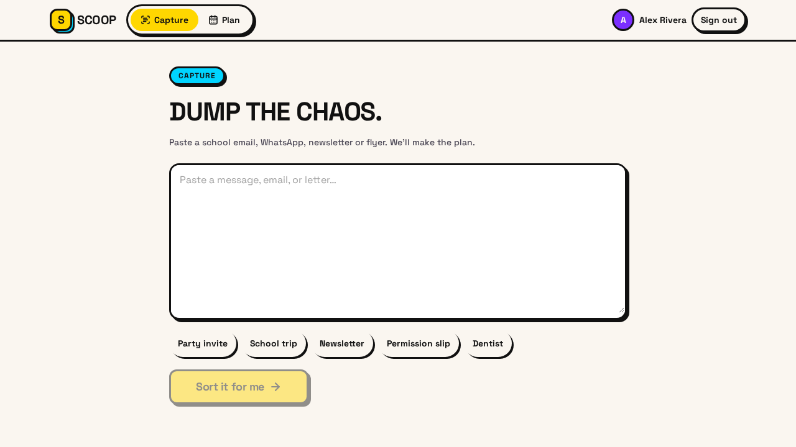
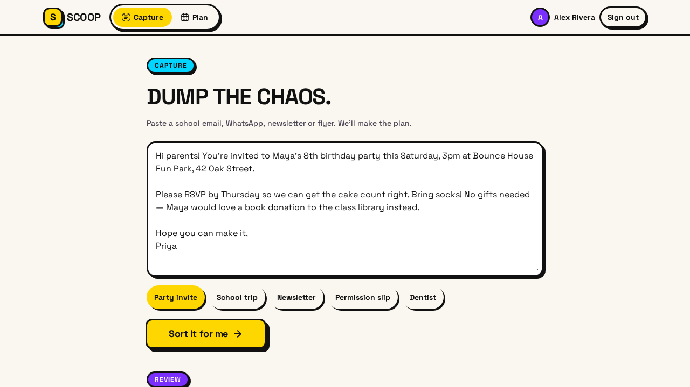
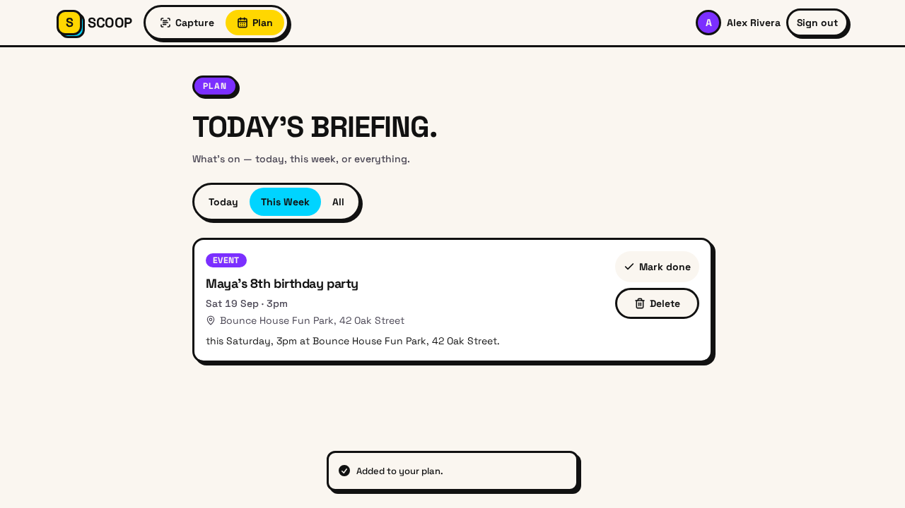

# SCOOP

**The family admin app that turns school chaos into a calm family plan.**

Every parent knows the feeling. Your inbox is a wall of school newsletters, the class WhatsApp group has 84 unread messages, and there's a paper flyer somewhere at the bottom of a book bag. The permission slip is due tomorrow. You think. The trip is on Thursday. Probably.

SCOOP takes that mess and gives you back one clear plan.

## How it works

**1. Paste the chaos.** Drop in a school email, a WhatsApp thread, a newsletter, or the text off a flyer. Any messy text works — no formatting needed.

**2. SCOOP reads it.** You get back what actually matters, sorted into four types:

| | |
|---|---|
| **Events** | Trips, parties, parent-teacher evenings, clubs, school photos |
| **Deadlines** | Return slips, payments, forms, supply lists |
| **Tasks** | Pack the lunch, buy the uniform, bring the water bottle |
| **RSVPs** | Reply to a party, reserve a club spot, confirm a bus seat |

**3. You check it, then it's yours.** Every item is shown before it's saved. Fix a date, rewrite a title, bin what you don't need. Nothing reaches your plan until you say so.

## What's in your plan

- Everything in one place, in date order — no more hunting through three apps.
- Filter to **Today**, **This Week** or **All**.
- Tick items off, or delete them. The plan stays current.
- Send anything with a date to **Google Calendar**, or save it to your phone's calendar.
- Paste the same message twice and duplicates are skipped.

## What it doesn't do yet

Email forwarding, photo scanning, a WhatsApp bot, reminders and plan sharing between two accounts. We'd rather tell you what isn't built than pretend it is.

## Who it's for

Parents and carers who are the default keeper of the family calendar — the one everyone else asks, "what's on this week?"

## Screenshots

| Capture | Review | Your plan |
|---|---|---|
|  |  |  |

## Your data

We don't sell it, we don't advertise against it, and we don't build profiles out of your children's school life. You can delete any item at any time. The full detail is in the [privacy policy](https://scoopfamily.xyz/privacy).

## Contact

[scoopfamily.xyz](https://scoopfamily.xyz) · amritokundu719@gmail.com
